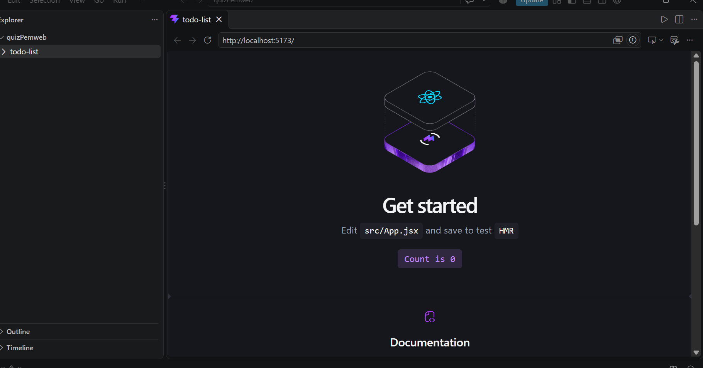

# TaskFlow – Aplikasi To-Do List

## Deskripsi
TaskFlow merupakan aplikasi To-Do List berbasis React.js yang digunakan untuk membantu pengguna mengelola daftar tugas sehari-hari.

Aplikasi ini dibuat sebagai tugas Kuis Praktikum Pengembangan Frontend menggunakan React.js.

## Teknologi
- React.js
- JavaScript
- HTML
- CSS
- Vite

## Fitur Aplikasi
1. Menampilkan daftar tugas.
2. Melihat detail tugas.
3. Menambahkan tugas baru.
4. Memperbarui tugas.
5. Menghapus tugas dengan konfirmasi.
6. Filter tugas berdasarkan status.
7. Mengelola data menggunakan React State.

## Atribut Data Tugas
- id
- title
- description
- priority
- deadline
- status

## Cara Menjalankan Aplikasi

1. Clone repository GitHub.
2. Buka folder project di VS Code.
3. Jalankan perintah:

```bash
npm install
```

4. Jalankan aplikasi:

```bash
npm run dev
```

5. Buka alamat localhost yang muncul di terminal.

## Screenshot Aplikasi


### Dashboard


### Tambah Tugas


### Detail Tugas


### Edit Tugas


### Hapus Tugas


### Filter Status


